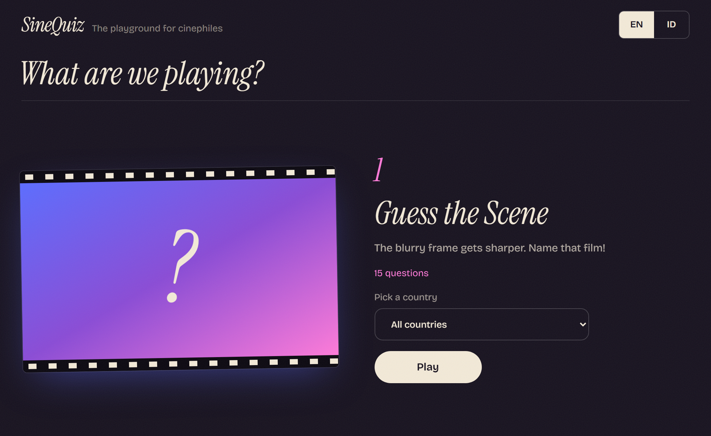

# 🍿 SineQuiz

**SineQuiz** is a movie trivia web app for everyone who thinks they're a movie buff. From guessing movies by their scenes to identifying actors and recalling entire casts, it's time to put your film knowledge to the test!

  

**[🎬 Play SineQuiz](https://sinequiz.vercel.app/)** · **[🐛 Report a bug](https://github.com/doobeedoobeedam/SineQuiz/issues)**

## Game Modes

| Mode | What you do  |
|---|---|
| **Guess the Scene** | guess the movie title from a scene |
| **Guess by Pixel Posters** | identify Marvel movies and films directed by Christopher Nolan through pixelated posters |
| **Titles Without Vowels** | guess the movie title with all its vowels removed |
| **Connect the Actors** | guess the movie that features two actors in the same film |
| **Guess the Actor** | identify an actor based on three movies they've starred in |
| **Name Their Films** | name as many movies as possible starring a particular actor |
| **Ensemble Cast** | name as many actors as you can from a movie's cast |

## Highlights

- **No accounts, no database.** Just play.
- **Shareable scorecards.** Export your result as a PNG.
- **Bilingual.** Play in Bahasa Indonesia or English.

## Tech Stack

- **[Next.js 15](https://nextjs.org/)** with the App Router and Route Handlers.
- **[React 19](https://react.dev/)**
- **[Tailwind CSS 3](https://tailwindcss.com/)**
- **[TMDB API v3](https://developer.themoviedb.org/)** for movies, posters, backdrops, and actor data.

 

---
 

*SineQuiz uses the TMDB API but is not endorsed or certified by TMDB.   
All posters, backdrops, and actor photos belong to their respective owners.*

Made by [Kusuma Wecitra](https://wecitra.github.io)

